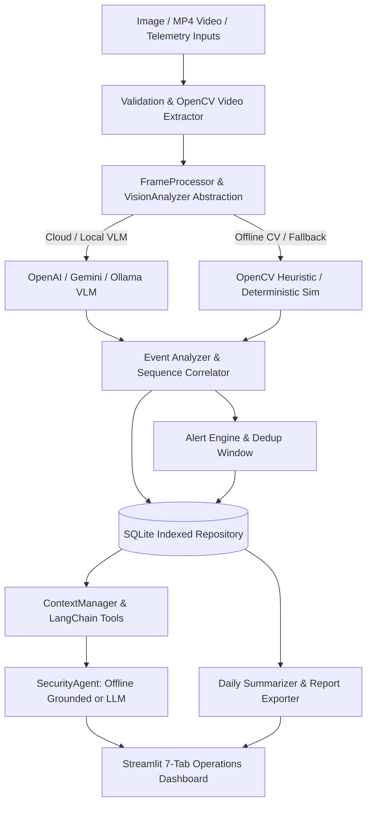

# DroneGuard AI — Intelligent Drone Security Analyst Agent

**Version:** 2.0.0

DroneGuard AI is a modular, SQLite-backed drone perimeter security monitoring and reasoning system. It combines configurable Vision-Language Model (VLM) and local OpenCV video/image analysis, cross-frame temporal event correlation, prioritized alerting with duplicate suppression, a multi-turn grounded Security Analyst Agent, and a 7-tab Streamlit security operations dashboard.

---

## Key Features

- **Multi-Provider VLM & Vision Pipeline (`core/vlm_providers.py`, `core/object_detection.py`)**
  - Supports **OpenAI Vision** (`gpt-4o-mini` / `gpt-4o`), **Google Gemini Vision** (`gemini-2.0-flash`), **Local Ollama VLMs** (`llava`), **Local OpenCV Heuristic CV** (pedestrian silhouette + HSV color/contour + motion delta), and **Deterministic Simulation Fallback**.
  - Every observation records `model_provider` and `analysis_mode` (`actual_vlm`, `local_cv_heuristic`, `simulation`, or `local_cv_fallback`) so simulated/heuristic outputs are never mislabeled as cloud VLM inference.
  - Retries transient HTTP 429/5xx errors, validates corrupt/empty uploads, and handles missing credentials gracefully.
- **OpenCV Video Frame Extraction (`core/video_extractor.py`)**
  - Extracts frames from `.mp4`, `.avi`, `.mov`, `.mkv`, `.webm` at configurable intervals (e.g., `0.5s`–`10s`), computes timestamps and inter-frame motion scores, and persists JPEG frame evidence.
- **Cross-Frame Security Reasoning & Alerting (`core/event_analyzer.py`, `core/alert_engine.py`)**
  - **Single-frame rules:** Vehicle observations, person detections, restricted-zone intrusions, midnight person presence (`00:00`–`05:00` configurable).
  - **Multi-frame sequence correlation:** Repeated vehicle attribute observations across timestamps/zones, vehicle entry/exit movement patterns, and windowed loitering detection (`LOITERING_SECONDS`).
  - **Drone safety monitoring:** Critical/low battery alerts and altitude threshold violations.
  - **Prioritization & deduplication:** `Critical`, `High`, `Medium`, `Low` tiers with configurable time-window duplicate suppression (`DUPLICATE_ALERT_WINDOW_SECONDS`) and `open` / `acknowledged` / `resolved` workflow.
- **Frame-by-Frame SQLite Indexing (`database/database.py`, `database/repository.py`)**
  - Indexed SQLite schema (`WAL` mode + foreign keys) with safe automatic column migrations and multi-facet search by description, object category, color, timestamp range, location, event type, source video, and analysis mode.
- **Grounded AI Security Analyst (`agent/security_agent.py`, `agent/agent_tools.py`, `core/context_manager.py`)**
  - Multi-turn conversation state for follow-up questions (*"Which frames were those?"*), natural-language time-window parsing (*"between 12 PM and 3 PM"*), and 8 LangChain-compatible `@tool` functions.
  - Works 100% offline via deterministic SQLite retrieval, or optionally uses OpenAI/Gemini/Ollama strictly to summarize retrieved database rows with frame ID & timestamp citations.
- **7-View Streamlit Console (`app.py`, `ui/`)**
  - Separate sidebar-routed views for Overview, Video & Image Analysis, Frame Intelligence, Security Alerts, Drone Telemetry, AI Security Analyst, and Daily Report & Benchmarks (with Markdown/JSON exports).

---

## Architecture



---

## Technology Stack

| Layer | Technology |
|---|---|
| Language | Python 3.11+ (tested on Python 3.13.7, Windows 11) |
| Vision / Video | `opencv-python-headless`, `Pillow`, `numpy`, `httpx` |
| Persistence | SQLite 3 (WAL mode, indexed relational schema) |
| Agent & Tools | `langchain-core` tools + custom stateful `ContextManager` |
| Dashboard | `streamlit`, `pandas` |
| Testing | `pytest` |

---

## Prerequisites & Windows Setup

1. Install **Python 3.11+** (ensure `Add Python to PATH` is checked).
2. Clone or extract the `DroneGuard-AI` directory.
3. Run `setup_windows.bat` or execute manually in PowerShell / CMD:

```powershell
python -m venv venv
.\venv\Scripts\activate
python -m pip install --upgrade pip
pip install -r requirements.txt
copy .env.example .env
```

---

## Running the Application

1. (Optional) Generate sample synthetic images and patrol MP4 video, and load the demo database:

```powershell
.\venv\Scripts\python.exe -m scripts.generate_sample_media
.\venv\Scripts\python.exe -m scripts.generate_sample_data
```

2. Launch the Streamlit dashboard (or double-click `run_windows.bat`):

```powershell
.\venv\Scripts\python.exe -m streamlit run app.py
```

Open `http://localhost:8501` in your browser.

---

## Configuring a Real VLM / LLM Provider

By default, `.env` runs in offline mode without API keys (`VLM_MODE=simulation`, `LLM_PROVIDER=offline`). To enable live VLM/LLM inference, edit `.env` (never commit `.env`):

```env
VLM_MODE=auto
VLM_PROVIDER=openai        # openai | gemini | ollama | opencv_heuristic | simulation
LLM_PROVIDER=openai        # offline | auto | openai | gemini | ollama
OPENAI_API_KEY=sk-...
OPENAI_MODEL=gpt-4o-mini
# Or for Google Gemini:
GEMINI_API_KEY=AIza...
GEMINI_MODEL=gemini-2.0-flash
```

In the dashboard's **Video & Image Analysis** tab, you can also select `opencv_heuristic` to inspect actual pixel frames offline without an API key.

---

## Running Tests & Reproducible Benchmarks

Run the full automated test suite (23 tests):

```powershell
.\venv\Scripts\python.exe -m pytest -v
```

Run the reproducible experiments (interval trade-off, provider modes, alert deduplication, SQLite scalability up to 25,000 frames):

```powershell
.\venv\Scripts\python.exe -m scripts.run_experiments
```

Results and charts are saved to `reports/experiment_results.json` and `reports/charts/`.

---

## Example Analyst Queries

- `"How many vehicles were detected today?"` -> Returns count and frame citations (`FR-0001`, `FR-0004`).
- `"Show all observations of blue vehicles"` -> Filters detections by `object_type=vehicle, color=blue`.
- `"Which frames were those?"` -> Multi-turn follow-up resolving prior frame IDs.
- `"Was anyone near the main gate at midnight?"` -> Queries `00:00–05:00` window + `Main Gate` -> cites `FR-0003`.
- `"Did the same vehicle appear more than once?"` -> Returns `repeated_vehicle_observation` correlation with explicit attribute-matching caveat.
- `"What happened between 12 PM and 3 PM?"` -> Parses time window (`12:00:00–15:00:59`) and excludes midnight events.
- `"Which security events require attention?"` -> Lists prioritized open/unacknowledged alerts.
- `"Summarize today's drone activity"` -> Returns grounded summary + per-video one-sentence summaries.

---

## Known Limitations

1. **No persistent cross-frame Re-ID / license plate tracking:** Repeated vehicle and loitering correlations rely on visual attributes (category, color) and zone/time windows, not biometric or license-plate identity continuity.
2. **Offline OpenCV heuristic boundaries:** Without a cloud or Ollama VLM, `OpenCVHeuristicAnalyzer` uses pixel luminance, HSV color contours, and silhouette heuristics rather than open-vocabulary semantic reasoning.
3. **Single-node SQLite & local storage:** Production fleet deployments would require PostgreSQL/TimescaleDB, object storage (S3/GCS), RBAC authentication, encrypted media retention, and RTSP/WebRTC streaming.
